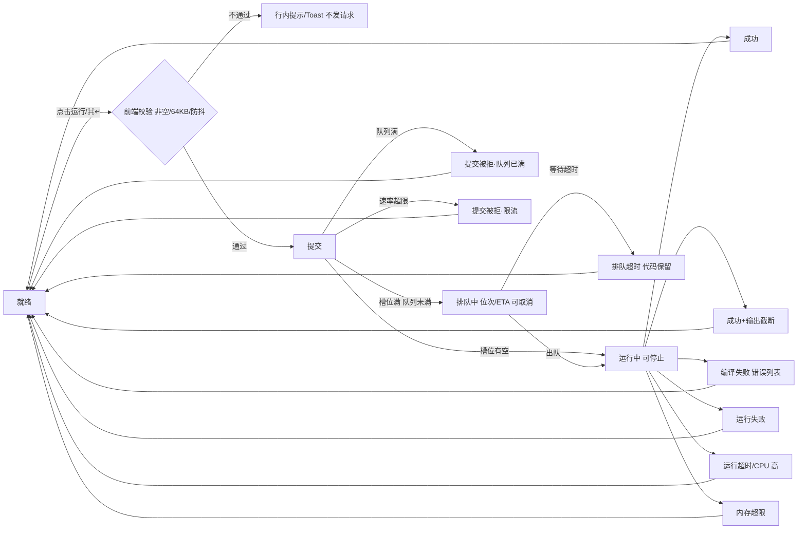

# golang-sandbox UI 设计规范

| 项 | 内容 |
|---|---|
| 版本 | V1.0 |
| 日期 | 2026-10-20 |
| 产出方 | UI 设计专家（LUOT-5） |
| 设计输入 | `docs/requirements.md` @ `da9100f`（唯一基线，V2 修订版） |
| 配套原型 | `docs/design/prototype.html`（自包含单文件，浏览器直接打开；右下角「设计预览」面板可切换全部 17 个状态，亦可用 `?state=<key>` 直达，如 `prototype.html?state=oom`） |
| 对比度验证 | `docs/design/contrast-check.py`（36 组文本/非文本组合 100% 通过 WCAG 2.1 AA） |
| 状态 | 待验收（按需求文档逐项验收） |

## 一、设计方向

**选定方向：「浅色工作台 × 深色画布」。**

页面框架（顶栏、卡片头、按钮、提示条）用浅色；代码编辑器与输出区用深色画布。整页只有一张桌面：左侧写代码，右侧看结果，一按运行。

- **Why（可用性依据）**：在线运行平台的视觉焦点是代码与输出。深色画布上语法高亮与状态色的对比度冗余更大（正文均 ≥ 7:1），浅色 chrome 保持页面轻盈并降低视觉疲劳；同时延续 Go Playground 的产品心智，用户零学习成本。浅色 UI 的中文正文与表单控件更容易稳定满足 WCAG AA。
- **备选方向「全暗色 IDE 风」未选作默认**：全暗对中文正文与控件对比度要求更苛刻，首访友好度略低。Token 体系已按「状态色与画布解耦」设计，暗色主题可作为 P2 扩展（见附录 C），不需要重构。
- 风格关键词：克制、清晰、工程师审美。

## 二、页面结构与布局

```text
┌──────────────────────────────────────────────────────────────────┐
│ 顶栏  [Go] golang-sandbox · 在线 Go 运行平台   Go 1.23.2  ●●○ 2/3 │ 56px
├───────────────────────────────┬──────────────────────────────────┤
│ 编辑器卡片（浅色卡头 + 深色画布）│  输出卡片（浅色卡头 + 深色画布）      │
│ ┌───────────────────────────┐ │ ┌──────────────────────────────┐ │
│ │ main.go   [格式化][stdin] │ │ │ 状态徽章  耗时 · trace · 复制  │ │
│ ├───────────────────────────┤ │ ├──────────────────────────────┤ │
│ │ （草稿恢复横幅，条件出现）    │ │ │ 状态横幅（排队/错误/拒绝…）    │ │
│ ├───────────────────────────┤ │ ├──────────────────────────────┤ │
│ │ 行号 │ 代码编辑画布（深色）  │ │ │ stdout/stderr 输出流（深色）   │ │
│ │      │                     │ │ │ （截断提示固定在输出末尾）      │ │
│ ├───────────────────────────┤ │ ├──────────────────────────────┤ │
│ │ [▶ 运行 ⌘↵]  Ln,Col · 大小 │ │ │ 空态：运行后输出显示在这里      │ │
│ └───────────────────────────┘ │ └──────────────────────────────┘ │
├──────────────────────────────────────────────────────────────────┤
│ 页脚  代码仅用于本次运行，平台不留存 · 状态页 · 键盘提示              │ 40px
└──────────────────────────────────────────────────────────────────┘
```

- 双栏 `grid`：`minmax(0, 1.05fr) minmax(0, 1fr)`，列间 16px，页面左右留白 20px，最大宽度 1560px 居中。
- 双栏均为全高卡片（`calc(100vh − 顶栏 − 页脚 − 间距)`），编辑器与输出各自内部滚动，互不牵扯；运行时视线不需要跳动。
- 编辑器卡片内的「运行」按钮与输出卡片的状态徽章位于同一水平视线带：点运行 → 抬眼即见结果状态。

### 断点

| 断点 | 布局 |
|---|---|
| ≥ 1280px | 双栏并排（默认） |
| 1024 – 1279px | 双栏并排，列宽收窄为 1fr/1fr |
| < 1024px | 单栏纵向堆叠：编辑器（高 400px）在上、输出（高 ≥ 320px）在下；顶栏折叠副标题 |
| < 640px | 工具按钮仅保留图标 + aria-label；触控目标 ≥ 44px；输出头部元信息允许换行 |

移动端「可浏览、可编辑」，不承诺完整体验（与需求文档兼容边界一致）。

## 三、Design Tokens

### 3.1 颜色

中性色（浅色 chrome）：

| Token | 值 | 用途 |
|---|---|---|
| `--bg` | `#F8FAFC` | 页面背景（顶部 240px 叠加 `#EEF9FC→透明` 品牌渐变） |
| `--card` | `#FFFFFF` | 卡片、卡头背景 |
| `--border` / `--border-strong` | `#E2E8F0` / `#CBD5E1` | 常规边 / 分隔线 |
| `--text` / `--text-2` / `--text-3` | `#0F172A` / `#334155` / `#475569` | 主文案 / 次级 / 辅助（17.1 / 10.4 / 7.6 :1） |
| `--text-muted` | `#64748B` | 占位符、页脚说明（4.8 :1） |

画布（深色）：

| Token | 值 | 用途 |
|---|---|---|
| `--panel` / `--panel-2` | `#0D1526` / `#0A111E` | 编辑器 / 输出画布与行号槽 |
| `--panel-border` | `#1E293B` | 画布内分隔 |
| `--panel-text` | `#E2E8F0` | 代码与 stdout 正文（14.8 :1） |
| `--panel-muted` | `#94A3B8` | 画布内辅助文本、行号（7.1 :1） |

品牌色（Go Cyan，可随品牌替换）：

| Token | 值 | 用途与理由 |
|---|---|---|
| `--brand` | `#0891B2` | 焦点环、活跃指示（对白 3.7 :1，非文本 ≥ 3 :1 达标） |
| `--brand-text` | `#0E7490` | 链接与品牌色文字、主按钮底色（对白 5.4 :1） |
| `--brand-strong` | `#155E75` | 主按钮 hover（7.3 :1） |
| `--brand-soft` / `--brand-tint` | `#CFFAFE` / `#ECFDFF` | 品牌浅底、选中态 |

**说明**：Go 官方青 `#00ADD8` 对白色仅 ≈2.9 :1，直接作文字/按钮底色不达 AA，故降饱和为上表交互色，`#00ADD8` 仅用于装饰性大色块（logo 渐变）。

状态色（浅色徽章：深字 + 浅底；深色横幅：亮字 + 10% 色染底）：

| 语义 | Token（浅底 / 深字 / 画布亮字） | 值 | 对比度 |
|---|---|---|---|
| 等待（排队） | `--blue-bg` / `--blue-text` / `--blue-bright` | `#DBEAFE` / `#1D4ED8` / `#93C5FD` | 5.5 / 9.0 :1 |
| 活跃（运行中） | `--brand-soft` / `--brand-text` / `--cyan-bright` | `#CFFAFE` / `#0E7490` / `#67E8F9` | 4.8 / 10.9 :1 |
| 成功 | `--ok-bg` / `--ok-text` / `--ok-bright` | `#DCFCE7` / `#15803D` / `#6EE7B7` | 4.6 / 10.2 :1 |
| 代码错误·编译期 | `--rose-bg` / `--rose-text` / `--rose-bright` | `#FFE4E6` / `#BE123C` / `#FDA4AF` | 5.2 / 8.9 :1 |
| 代码错误·运行期 | `--red-bg` / `--red-text` / `--red-bright` | `#FEE2E2` / `#B91C1C` / `#FCA5A5` | 5.3 / 8.8 :1 |
| 资源与容量受限 | `--amber-bg` / `--amber-text` / `--amber-bright` | `#FEF3C7` / `#92400E` / `#FCD34D` | 6.4 / 10.9 :1 |
| 提交被拒 | `--orange-bg` / `--orange-text` / `--orange-bright` | `#FFEDD5` / `#9A3412` / `#FDBA74` | 6.4 / 9.7 :1 |
| 内存超限 | `--violet-bg` / `--violet-text` / `--violet-bright` | `#EDE9FE` / `#6D28D9` / `#C4B5FD` | 6.0 / 8.9 :1 |

**色族语义（贯穿全部组件，用户只需学一次）**：蓝 = 在等待 · 青 = 正在跑 · 绿 = 成功 · 红 = 代码问题（玫红=编译期、正红=运行期，配阶段标签）· 琥珀 = 资源/容量受限 · 橙 = 平台拒绝提交 · 紫 = 内存超限（独立色相，确保与「运行失败」一眼区分，落实需求文档第六节「区分展示」硬要求）。

Go 语法高亮（深色画布上，均 ≥ 7 :1）：关键字 `#7DD3FC`、字符串 `#86EFAC`、数字 `#FCD34D`、内建函数 `#F0ABFC`、类型 `#5EEAD4`、注释 `#94A3B8`、默认文本 `#E2E8F0`。

### 3.2 字体

| Token | 值 |
|---|---|
| `--sans` | `-apple-system, BlinkMacSystemFont, 'Segoe UI', 'PingFang SC', 'Hiragino Sans GB', 'Microsoft YaHei', sans-serif`（系统栈，零字体加载成本，中文渲染最优） |
| `--mono` | `ui-monospace, 'SF Mono', 'Cascadia Code', 'JetBrains Mono', Menlo, Consolas, monospace` |

字号阶梯：`12`（辅助/徽章）· `12.5`（输出/代码可选）· `13`（代码默认）· `13.5`（正文辅助）· `14`（正文/按钮）· `16`（卡片标题）· `18`（页面标题）。行高：正文 1.6，代码 22px（固定值，编辑器逐像素对齐的前提）。代码区 `tab-size: 4`（Go 惯例 Tab 缩进）。

### 3.3 间距 / 圆角 / 阴影 / 层级

- 间距：4px 基网，常用 `4 / 8 / 12 / 14 / 16 / 20 / 24 / 32`；卡片内边距 14px，卡片间 16px。
- 圆角：控件 `6px`、卡片/画布 `10px`、徽章 `999px`。全局统一，不出现第四种值。
- 阴影三级：`shadow-1 0 1px 2px rgba(15,23,42,.05)`（卡片静置）、`shadow-2 0 4px 12px rgba(15,23,42,.08)`（悬浮/下拉）、`shadow-3 0 12px 32px rgba(15,23,42,.16)`（弹层/Toast）。深色画布内不用阴影，用 1px 边框分层。
- 动效：快速反馈 `120ms`、面板/抽屉 `200ms`，缓动 `ease-out`；遵循 `prefers-reduced-motion` 时全部动效禁用。

## 四、状态系统（核心：与需求文档具名状态一一对应）

统一原则（引自需求文档第六节并全程执行）：**所有终态 = 具名状态徽章 + 一句话原因 + 恢复建议**，不透出原始堆栈、退出码细节或沙箱内部实现；资源类终止与代码类失败必须可区分。

### 4.1 全量状态映射表

| # | 状态（文档出处） | 徽章（图标+文案+色） | 用户可见文案 | 面板呈现 | 恢复动作 |
|---|---|---|---|---|---|
| 1 | 排队中（B1/D6） | 列表图标 ·「排队中」· 蓝 | 「第 N 位 · 预计等待约 M 秒，可随时取消」 | 排队横幅 + 等待进度条；输出区空态；运行钮变「排队中…」+「取消」 | [取消排队]（B4） |
| 2 | 运行中（B1） | 脉冲圆点 ·「运行中」· 青 | 「正在执行…」+ 已用时计时 | 输出区旋转指示；运行钮禁用 +「停止」 | [停止]（B4） |
| 3 | 成功（B1） | 对勾 ·「运行成功」· 绿 | —（输出即内容） | stdout/stderr 按时序混合流；底部耗时 + trace id | [重新运行] |
| 4 | 输出截断（D4，成功的子状态） | 琥珀 ⚠ 行内块，附于输出末尾 | 「输出超过上限，已截断（丢弃 N 字节）」 | 保留前段输出 + 截断标记块 | [重新运行] |
| 5 | 编译失败（B1/B2） | 八角叉 ·「编译失败」· 玫红 | 「编译失败 · N 个错误」+ 错误列表 | 错误列表（`文件:行:列 + 信息`），点击定位编辑器对应行并闪烁高亮 | 修正代码后 [重新运行] |
| 6 | 运行失败（B1） | 警告 ·「运行失败」· 正红 | 「程序异常退出（exit status 2），stderr 为程序自身输出」 | stderr 原样展示（程序输出非内部信息）；横幅给建议 | 检查代码后 [重新运行] |
| 7 | 运行失败·进程/线程超限（六） | 警告 ·「运行失败 · 资源受限」· 正红 | 「程序创建的进程/线程超过限制，已被终止」+ 建议「减少 goroutine/子进程并发」 | 与 #6 同族但标题带「资源受限」，明示不是代码逻辑错 | [重新运行] |
| 8 | 运行超时（B3/六） | 时钟 ·「运行超时」· 琥珀 | 「程序运行超过 10 秒，已被强制终止」+「已产生的输出照常展示，输出可能不完整」 | 部分输出照常展示；时限 N 由后端配置下发 | 优化后 [重新运行] |
| 9 | 运行超时·CPU 打满（六） | 同 #8（以「运行超时」呈现） | #8 文案附加「程序 CPU 占用较高，可尝试优化计算密集逻辑」 | 同 #8 | 同 #8 |
| 10 | 内存超限（六） | 内存条图标 ·「内存超限」· 紫（独立色相） | 「程序使用内存超过 256MB 限制，已被终止」+ 建议「降低内存占用，如减小缓冲区分批处理」 | 独立横幅；与「运行失败」严格区分 | [重新运行] |
| 11 | 排队超时（五/六） | 时钟 ·「排队超时」· 琥珀 | 「等待执行超时，请稍后重试」+「代码已保留在编辑器中，不会丢失」 | 横幅；编辑器代码原样保留（硬要求） | [重新排队] / 稍后再试 |
| 12 | 提交被拒·队列已满（五） | 禁止符号 ·「提交被拒绝」· 橙 | 「当前排队已满，请稍后再试」+「平台不会自动重复提交」 | 横幅；**无自动重试** | [手动重试] |
| 13 | 提交被拒·触发限流（五） | 禁止符号 ·「提交被拒绝」· 橙 | 「操作过于频繁，请稍后再试」 | 横幅；手动重试按钮 10s 冷却倒计时 | [手动重试]（冷却后可点） |
| 14 | 就绪/空闲 | 灰点 ·「就绪」· 中性 | — | 输出区空态「运行后，程序输出将显示在这里」 | [运行] |
| 15 | 编辑器为空（七） | 「运行」保持可点 | — | 提交空代码走 #5 编译失败链路：「expected package, found EOF」 | 编写代码 |
| 16 | 代码超 64KB（A1） | 编辑器页脚计数变红 | 「代码超过 64 KB 上限，请精简后运行」 | 运行钮禁用；点击弹 Toast 说明 | 精简代码 |

### 4.2 状态机



### 4.3 排队进度反馈方案（D6 升 P0 的专门回应）

- **位次**：横幅标题直接给「第 N 位」；N 变化时横幅内容原位更新并轻微高亮一次（200ms），不弹新提示。
- **预计等待**：`ETA ≈ 位次 × 近 20 次滚动平均单次运行时长`（上限为执行时限），由后端计算随状态下发；前端每秒倒计时递减显示「约 M 秒」。后端未实现估算前显示「预计等待计算中…」占位，不显示假数字。
- **等待进度条**：横幅底部 3px 细条，`已等待 / ETA` 比例推进，给「在动」的确定感（排队必为常态体验，感知进度不可省）。
- **可取消**：横幅内 [取消排队] + 运行钮位同享；取消立即回「就绪」并 Toast「已取消排队，槽位已释放」（B4）。
- **排队超时**：倒计时归零即转 #11 状态；编辑器代码与 stdin 一字不动。

## 五、组件规范

### 5.1 顶栏

- 左：品牌标（渐变青圆角块 + “Go”）+ 名称 `golang-sandbox` + 副标题「在线 Go 运行平台」。
- 右（依次）：**Go 版本徽章**（E3，如 `Go 1.23.2`，由后端 `/version` 下发，原型为示例值）；**容量指示**（可选增强，P1 随 E1/E2 数据上线：3 个圆点=运行槽位，实心=占用，配 `2/3` 计数与悬停提示「运行槽位 2/3 · 队列等待 N 人」；P0 阶段隐藏）。

### 5.2 编辑器卡片（A1 / A2 / A4 / B5）

- **卡头**：文件页签 `main.go`（单文件产品，固定不可增删——负向验收：无多文件入口）；右侧工具：[格式化]（A2）、[stdin] 开关（B5）。
- **编辑画布**：深色；语法高亮、行号、当前行光标；`Tab` 插入制表符；回车自动缩进（`{` 后多一层）；括号/引号自动配对与越过；行高 22px 逐像素对齐。实现建议 CodeMirror 6（见九）。
- **首次访问**（A1/七）：自动载入 Hello World 模板（`package main` + `fmt.Println("hello, 世界")`），保证新用户第一动作就能跑起来。
- **草稿恢复**（A4）：输入防抖 400ms 写 `localStorage`；刷新/重开检测到草稿与模板不同 → 画布顶部横幅「检测到上次未保存的草稿（保存于 HH:MM）」+[恢复]/[丢弃]；纯客户端，与服务端无持久化承诺不冲突。
- **stdin 抽屉**（B5）：卡头开关展开，置于编辑画布与页脚之间；说明文案「一次性预填，随代码一起提交（非交互）；stdin 为空时程序读输入将立即得到 EOF」。占位符示例 `100 20`。
- **页脚**：`Ln 5, Col 21` · 字节数 `1.2 KB / 64 KB`（>64KB 变红并禁用运行，A1 前端校验）· [重置示例]。
- **格式化反馈**（A2）：成功 → Toast「已按 gofmt 风格整理」；语法错误 → **代码保持原样**，Toast（玫红）附失败原因。

### 5.3 运行控制（B1/B4/七）

- 主按钮 [▶ 运行]（品牌青，白字 5.4:1），快捷键 `⌘/Ctrl + Enter`，按钮旁常驻快捷键提示。
- 模式矩阵：

| 模式 | 主按钮 | 伴随 |
|---|---|---|
| 就绪/完成 | [▶ 运行] 可点 | — |
| 排队中 | [排队中…] 禁用 | [取消] 可点 |
| 运行中 | [运行中… + 旋转] 禁用 | [停止] 可点 |
| >64KB | 禁用 | 点击弹 Toast 说明 |

- **防抖**（七）：点击后立即进入对应模式不可重复提交；双击/连点无第二次请求。
- 取消/停止（B4）：两态均可取消，立即回「就绪」，Toast「已停止，槽位已释放」。
- 空代码可直接点运行：按七走编译失败链路（见 4.1 #15），不给死按钮。

### 5.4 输出卡片（B1/D4/七）

- **卡头（状态条，`aria-live=polite`）**：左 = 状态徽章（4.1 表）；右 = 元信息 `耗时 0.42 s · trace 7f3a9c2e` + [复制输出] + [清空]（完成后出现）。trace id 常驻展示（七「排障抓手」）。
- **状态横幅区**：终态时渲染 4.1 表对应横幅（图标+标题+一句话原因+建议+动作按钮），色彩遵循色族语义。
- **输出流**：stdout 与 stderr **按到达时序混合**展示（贴近真实运行语义）；每行前 44px 源标签列 `out`（灰）/`err`（红）；stderr 正文 `#FDA4AF`。**输出一律按纯文本转义渲染**（七 XSS 要求：`<script>` 必须原样可见不执行——实现层禁止 innerHTML 拼接输出，用 `textContent`）。
- **截断标记**（D4）：输出末尾固定琥珀块「⚠ 输出超过上限，已截断（丢弃 N 字节）」，不与输出混排。
- **空态**：终端图标 +「运行后，程序输出将显示在这里」；运行中显示旋转指示 +「正在执行…」。
- [清空] 回到空态与「就绪」。

### 5.5 编译错误列表（B2）

- 位于输出横幅区：每行为整行可点按钮 `main.go:7:15  undefined: fmt.Prtintln`（行列用品牌青等宽字，信息用正文白）。
- 点击 → 编辑器滚动至对应行、光标落位、该行玫红底持续标注 + 1.6s 闪烁高亮；错误行同时常驻标注（编译失败期间）。
- 错误行支持键盘 Tab 聚焦 + Enter 定位（无障碍）。

### 5.6 排队反馈卡（D6）

见 4.3。视觉：蓝色横幅族，标题「排队中 · 第 N 位」，正文含 ETA 与可取消说明，底部等待进度条，动作区 [取消排队]。排队期间输出区保持空态，运行钮呈排队模式。

### 5.7 提交被拒提示（D5）

橙色横幅族，两种文案严格区分（队列已满 / 操作过于频繁），均附 [手动重试]；**前端不做任何自动重试**（负向验收要求）。限流拒绝的重试按钮带 10s 冷却倒计时（禁用态显示剩余秒数），避免用户无谓连点。

### 5.8 草稿恢复（A4）

见 5.2。横幅为品牌蓝浅底，非弹窗（不打断），提供 [恢复] / [丢弃] 双明确动作；丢弃同时清除 `localStorage`。

### 5.9 页脚

「代码仅用于本次运行，平台不留存」（E5，常驻可见）· ⓘ 点开浮层给完整隐私说明（含日志仅留 trace id 等排障最少信息）· 状态页链接（E1，P1 上线前隐藏）· 键盘提示「⌘/Ctrl+Enter 运行」。

### 5.10 Toast

顶部居中滑入，白卡 + 色族图标 + 标题 + 一句话正文，3.6s 自动消失；用于格式化结果、取消确认、64KB 拦截等轻反馈（不承载任何终态——终态一律进输出卡）。

## 六、无障碍（WCAG 2.1 AA，已验证）

- **对比度**：全部 36 组文本/非文本组合通过脚本验证（`docs/design/contrast-check.py`），正文 ≥ 4.5:1（画布上实际 ≥ 7:1），焦点环/边框等非文本 ≥ 3:1。验证范围含浅色徽章、深色横幅、语法高亮、行号。
- 焦点：所有可交互元素 `:focus-visible` 2px `--brand` 环 + 2px 偏移，键盘可达（Tab 顺序：运行钮 → 工具钮 → 编辑器 → stdin → 错误列表 → 输出操作）。
- 状态变化：状态徽章与横幅容器 `aria-live="polite"`、`role="status"`；排队位次/ETA 更新可被读屏感知。
- 编辑器：真实 `<textarea>` 承载输入（读屏/输入法兼容），高亮层 `aria-hidden`；行号列 `aria-hidden`。
- 图标一律 `aria-hidden`，配文字或 `aria-label`；动效遵循 `prefers-reduced-motion`。

## 七、响应式与兼容

- 兼容目标：Chrome/Edge/Firefox/Safari 近两个大版本（需求基线）。
- 断点行为见第二节；移动端触控目标 ≥ 44px，编辑器/输出高度固定可滚动，避免整页跳动。
- 深色画布固定为深色（不随系统深色模式切换；页面 chrome 的暗色主题为 P2 扩展）。

## 八、实现建议（供前端/全栈 LUOT-6 直接落地）

- **技术栈**：React 18 + Tailwind CSS（本稿 Token 一比一映射为 `tailwind.config` theme 扩展）+ **CodeMirror 6**（`@codemirror/lang-go` 提供语法高亮/括号配对/自动缩进，体积与可维护性优于 Monaco；行高 22px 与本稿一致）。原型 `prototype.html` 用原生实现演示同等体验，可作为还原基准。
- **状态机**：以 4.2 为唯一状态真源（`idle / queued / running / success / compile_error / runtime_error / timeout / oom / queue_timeout / rejected`，rejected 带 `reason: queue_full | rate_limited`；截断为 success 的附加字段）。UI 严禁在状态机之外自造状态。
- **与后端契约假设**（需 LUOT-6 对齐，接口未定前以本稿为准）：
  - 提交 `POST /run {code, stdin}` → `{run_id, status}`；`status ∈ queued{position, eta_ms} | running | 终态`；
  - 状态获取：SSE 优先（`GET /run/{id}/events`），降级 500ms 轮询；
  - 终态载荷：`status, stdout[], stderr[], elapsed_ms, trace_id, truncated{dropped_bytes}?, compile_errors[{line,col,msg}]?, reject_reason?, exit_note?`；
  - 具名状态值与 4.1 表编号一一对应，后端不得合并返回（如不得用 `error` 混装超时/内存超限）。
- **安全**：输出渲染只走 `textContent`；前端不解析输出为 HTML。
- **前端校验**（提交前，不发请求）：代码非空、字节数 ≤ 64KB、防抖；与后端双重校验对应（A1）。

## 九、需求覆盖对照表（验收索引）

| 需求功能点 | 本稿位置 | 原型演示 |
|---|---|---|
| A1 编辑器（高亮/行号/Tab/括号配对/自动缩进/Hello World/64KB 前端校验） | §5.2 | 默认打开 + `?state=size_exceed` |
| A2 格式化（成功/失败保留代码） | §5.2 | 预览「格式化失败」 |
| A4 草稿本地恢复 | §5.2/§5.8 | 预览「草稿恢复」 |
| B1 运行与全量状态枚举（9 态） | §4.1 全表 | 预览面板对应项 |
| B2 编译错误列表 + 行号定位高亮 | §5.5 | `?state=compile_error` 点击错误行 |
| B3 超时终止（时限可配 N） | §4.1 #8/#9 | `?state=timeout` / `timeout_cpu` |
| B4 手动停止/取消排队 | §5.3 | 排队/运行中点取消 |
| B5 stdin 一次性预填（空=EOF 提示） | §5.2 | 卡头 stdin 开关 |
| C2 导入/导出（P2 保留观察） | 附录 A | — |
| D4 输出截断 + 丢弃字节数 | §4.1 #4/§5.4 | `?state=truncated` |
| D5 并发限流两拒绝文案 + 无自动重试 | §5.7 | `?state=reject_queue_full` / `reject_rate` |
| D6 排队位次/ETA/取消/等待超时 | §4.3/§5.6 | `?state=queued` 或直接点两次运行 |
| E1 状态页入口 | §5.9/附录 B | — |
| E3 Go 版本展示 | §5.1 | 顶栏徽章 |
| E5 隐私声明 | §5.9 | 页脚 ⓘ |
| 七-空态模板 / 空代码编译链路 | §5.2/§4.1 #15 | 清空代码点运行 |
| 七-XSS 转义 | §5.4/§八 | （实现层约束，spec+代码审） |
| 七-防抖/按钮禁用 | §5.3 | 连点运行 |
| 七-trace id / Go 版本 | §5.4/§5.1 | 输出卡头 |
| 七-移动端可浏览可编辑 | §二/§七 | 缩窄窗口 |
| 负向：无分享/多文件/历史/依赖入口 | §5.2 页签固定单文件；全局无此类入口 | — |

## 附录

**A.（P2 预留）导入/导出（C2）**：卡头「⋮」菜单加 [导入 .go…]（文件选择/拖拽到画布，超 64KB 拒绝并提示）/ [下载 main.go]；视觉遵循现有控件 Token，不新增色值。

**B.（P1 预留）状态页（E1）**：独立轻页：沙箱可用性、当前队列深度、近 1 小时成功率/P95；复用本稿状态色族，不新增组件体系。顶栏容量指示为其主页内联形态。

**C.（P2 预留）暗色主题**：本稿状态色「浅底深字/画布亮字」已解耦，暗色仅需替换 chrome 中性色与徽章底色组合并重跑对比度脚本。

**D. 品牌替换点**：品牌青 token 组（§3.1）、logo、产品名；其余 Token 与状态语义不受品牌影响。
