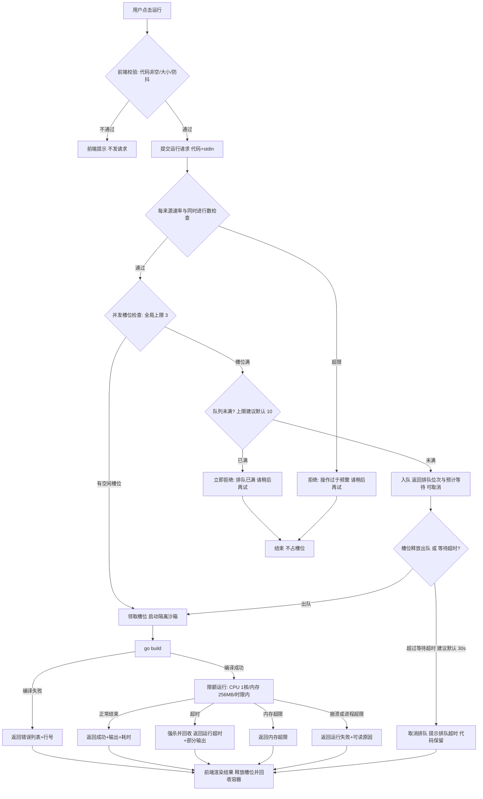

# golang-sandbox 需求拆解文档

| 项 | 内容 |
|---|---|
| 版本 | V2（修订版，取代初稿） |
| 日期 | 2026-10-20 |
| 产出方 | 需求拆解专家（LUOT-4 需求挖掘） |
| 验收 | 开发团队队长已验收通过（2026-10-20） |
| 状态 | **待需求方确认**，确认后作为 V1 开发基线，指导 UI 设计（LUOT-5）与功能实现（LUOT-6） |

## 需求方确认记录

| 时间（2026-10-20） | 确认项 | 结论 |
|---|---|---|
| 07:45 | 产品形态 | 在线 Go 运行平台 |
| 07:45 | 沙箱资源限制 | 最大并发 3、单次执行 CPU 1 核、内存 256MB |
| 07:45 | 附加功能 | 分享链接、多文件/第三方依赖、运行历史均**不需要** |
| 07:56 | 审查分工 | LUOT-7（需求功能审查）维持「全栈开发专家」负责，不改派 |
| 07:58 | 流程门槛 | 需求落实写入项目，需求方确认无误后才进入下个阶段 |

执行时限与网络策略两项数值需求方未给出，保留待确认（见「八、待确认问题清单」问题 1 / 2），均附默认建议值。

## 〇、修订说明（初稿 → V2）

| 初稿内容 | V2 修订 | 依据 |
|---|---|---|
| 待确认 1：多文件 / 第三方依赖是否纳入 V1 | **关闭**：均不纳入，A3 / D7 移入「不做范围」 | 需求方确认 3 |
| 待确认 2：账号体系与云端代码 / 历史保存 | **关闭**：无账号、无云端保存、无运行历史，B6 / C1 移入「不做范围」，平台无持久化状态 | 需求方确认 3 |
| 待确认 5：产品边界（仅 Go、独立站点） | **主体关闭**：独立在线 Go 运行平台确认成立；嵌入组件 C3 未在确认范围，默认不排期 | 需求方确认 1 |
| D1 资源限额（示例值） | **定值**：最大并发 3（硬性）、单次执行 CPU 1 核、内存 256MB | 需求方确认 2 |
| D5 并发限流（泛化描述） | **重写**：并发 3 为硬容量约束，新增提交排队 / 拒绝策略专项拆解（第五节） | 确认 2 + 队长要求 |
| B3 超时默认 5s | 改为**建议默认 10s**，保持待确认（问题 1） | 队长要求 |
| D2 网络隔离 | 默认按「禁用出网」拆解，保持待确认（问题 2） | 队长要求 |
| D6 排队状态反馈 P1 | **升级 P0**：并发仅 3，排队必为常态体验，无反馈的排队不可用 | 推论 |
| — | 新增第六节：资源超限场景的用户可见表现与错误提示 | 队长要求 |

## 一、需求概述

golang-sandbox 是 **Web 端在线 Go 代码运行平台**（需求方已确认）：用户无需安装任何环境，在浏览器中编写单文件 Go 代码，提交到服务端沙箱安全执行，页面返回运行输出与编译错误。用户代码在强隔离、限时限量的沙箱中执行，恶意代码无法影响宿主机。平台**不持久化任何状态**——无账号、无云端代码保存、无分享链接、无运行历史，代码仅用于本次运行。本文档为 V1 需求基线（V2 修订版），供 UI 设计（LUOT-5）与功能实现（LUOT-6）直接引用。

## 二、已确认基线与五维结论速览

**已确认基线（需求方 2026-10-20 答复）：**

1. 产品形态：在线 Go 运行平台——Web 端编写、服务端沙箱执行、返回输出与编译错误。
2. 资源限制：最大并发 **3**（硬性容量约束）、单次执行 CPU **1 核**、内存 **256MB**；执行时限、网络策略数值未给，保留待确认（见问题 1 / 2）。
3. 功能范围：**不需要**分享链接、多文件与第三方依赖、运行历史；收敛为**单文件代码、仅 Go 标准库、无持久化状态**。

| # | 维度 | 结论 | 状态 |
|---|------|------|------|
| 1 | 产品形态与边界 | 独立 Web 站点，匿名即用，无登录，仅 Go | **已确认** |
| 2 | 核心功能 | 编辑 / 运行 / 编译错误 / 状态展示为 P0；stdin、格式化、草稿恢复为 P1；多文件、第三方依赖、分享链接、运行历史**不做** | 已确认收敛 |
| 3 | 沙箱安全与资源限制 | 并发 3（硬性）+ CPU 1 核 + 内存 256MB（已确认）；执行时限（建议 10s）、禁用出网（默认）待确认；限流排队按第五节策略 | 数值已确认，2 项待确认 |
| 4 | 非功能需求 | 单次运行 P95 ≤ 5s（不含排队）；排队状态可见；结构化日志 + 指标告警；现代四大浏览器近两个大版本 | 已明确 |
| 5 | Out of Scope | 无账号、无分享、无多文件、无第三方依赖、无运行历史、无 REPL / 调试器 / 多语言 / 移动 App | 已确认 |

## 三、角色与权限

| 角色 | 说明 | 权限 |
|------|------|------|
| 匿名访客 | 核心用户，无需注册登录 | 编辑代码、提交运行、预填 stdin、取消排队 / 停止运行、本地草稿自动恢复；受并发排队与限流策略约束 |
| 运营/管理员（内部） | 平台运维人员 | 调整限额、队列与限流参数，查看监控日志；V1 不做管理后台，参数走配置并可回滚 |
| 沙箱执行器（系统角色） | 后端隔离执行环境 | 仅在限额内执行用户代码：1 核 / 256MB / 时限内 / 禁网（默认）/ 只读文件系统，运行结束即销毁 |

## 四、功能清单（V2）

优先级口径：**P0** = MVP 必须，缺则产品不成立；**P1** = 次版本重要能力；**P2** = 后续迭代。编号沿用初稿便于对照，「移出」行为需求方确认不做。

| 编号 | 模块 | 功能点 | 描述 | 优先级 |
|------|------|--------|------|--------|
| A1 | 代码编辑 | 在线编辑器 | 单文件 Go 代码编辑：语法高亮、行号、Tab 缩进、括号配对/自动缩进；首次打开加载 Hello World 模板；代码大小上限（建议 64KB）前后端双重校验 | P0 |
| A2 | 代码编辑 | 代码格式化 | 一键 gofmt；语法错误时保留原代码并提示失败原因 | P1 |
| A3 | 代码编辑 | ~~多文件工作区~~ | **移出 V1**：需求方确认不需要多文件 | — |
| A4 | 代码编辑 | 草稿本地恢复 | 编辑内容自动写入浏览器 localStorage，刷新/重开可恢复并提示「恢复/丢弃」；纯客户端行为，不涉及服务端持久化，与「无持久化状态」不冲突 | P1 |
| B1 | 运行与输出 | 运行代码 | 提交 → 排队/执行 → 展示 stdout/stderr、状态、耗时。**状态全量枚举**：排队中（位次/预计等待）/ 运行中 / 成功 / 编译失败 / 运行失败 / 运行超时 / 内存超限 / 排队超时 / 提交被拒绝 | P0 |
| B2 | 运行与输出 | 编译错误展示 | 编译失败展示错误列表并标注行号，点击定位并高亮编辑器对应行 | P0 |
| B3 | 运行与输出 | 超时终止 | 超过执行时限由后端强制终止并返回「运行超时」；时限**待确认，建议默认 10s**（备选 5s / 10s / 30s），平台可配 | P0 |
| B4 | 运行与输出 | 手动停止 | 运行中与排队中均可取消，立即释放槽位 | P1 |
| B5 | 运行与输出 | 标准输入支持 | 一次性预填 stdin 随代码提交（交互形态待确认，问题 3）；stdin 为空时程序读输入得到 EOF | P1 |
| B6 | 运行与输出 | ~~运行历史~~ | **移出 V1**：需求方确认不需要 | — |
| C1 | 保存与分享 | ~~分享链接~~ | **移出 V1**：需求方确认不需要 | — |
| C2 | 保存与分享 | 导入/导出 | 上传/拖入 .go 导入编辑器；当前代码下载为 .go（未在确认范围，保留观察） | P2 |
| C3 | 保存与分享 | 嵌入组件 | 产品形态已确认为独立站点；嵌入未在本次确认范围，**默认不排期**，如需另立需求评估 | — |
| D1 | 沙箱安全 | 资源限额 | **已确认：CPU 1 核、内存 256MB**；进程/线程数上限（建议 64，防 fork 炸弹）、输出上限（建议 1MB）、tmpfs 上限（建议 16MB）为建议默认值，可配 | P0 |
| D2 | 沙箱安全 | 网络隔离 | 默认按「**禁用出网（含内网）**」拆解（待确认，问题 2）；网络请求在时限内失败，错误信息不暴露沙箱内部拓扑 | P0 |
| D3 | 沙箱安全 | 文件系统隔离 | 根文件系统只读，仅 tmpfs 可写且有容量上限，运行结束即销毁，宿主机零残留 | P0 |
| D4 | 沙箱安全 | 输出截断 | stdout/stderr 超上限截断，返回截断标记与已丢弃字节数 | P0 |
| D5 | 沙箱安全 | 并发上限与限流 | **全局最大并发 3，硬性容量约束（已确认）**；每来源速率与同时进行数限制；并发满按第五节排队/拒绝策略处理 | P0 |
| D6 | 沙箱安全 | 排队状态反馈 | 排队位次、预计等待、等待超时提示，前端展示（自 P1 升级 P0） | P0 |
| D7 | 沙箱安全 | ~~第三方依赖支持~~ | **移出 V1**：仅 Go 标准库，需求方已确认 | — |
| D8 | 沙箱安全 | 沙箱加固 | 非 root 最小权限、seccomp、no-new-privileges、最小化镜像、定期更新基线 | P1 |
| E1 | 平台运营 | 健康检查与状态页 | 健康探针与对外状态页（沙箱可用性、队列深度） | P1 |
| E2 | 平台运营 | 可观测性 | 指标（运行数、成功率、P95 耗时、超时率、**队列深度与排队时长**）+ 结构化日志（含 trace id）+ 失败/积压告警 | P1 |
| E3 | 平台运营 | 环境信息展示 | 页面展示沙箱 Go 版本 | P1 |
| E4 | 平台运营 | 限额运营配置 | 时限、并发、队列、限流、内存、输出等参数集中配置、可热更、可回滚 | P2 |
| E5 | 平台运营 | 留存与隐私声明 | 「代码仅用于本次运行、平台不留存」说明文案与日志留存策略 | P2 |

## 五、核心流程与并发 3 硬上限下的提交策略

**提交排队 / 拒绝策略**（并发 3 为硬上限，策略为建议方案，参数见待确认问题 4）：

| 时点 | 条件 | 系统行为 | 用户可见 |
|------|------|----------|----------|
| 提交时 | 运行槽位 < 3 | 直接执行 | 状态「运行中」 |
| 提交时 | 槽位满，队列未满（建议上限 10） | 入队等待 | 「排队中」+ 位次 / 预计等待，可取消排队 |
| 提交时 | 队列已满 | 不入队，立即拒绝 | 「当前排队已满，请稍后再试」；前端不自动重试轰炸，提供手动重试 |
| 排队中 | 有槽位释放 | 出队执行 | 状态转「运行中」 |
| 排队中 | 等待超过超时（建议 30s） | 自动取消本次排队 | 「排队超时，请稍后重试」；**编辑器代码不丢失** |
| 任意提交 | 每来源速率 / 同时进行数超限（建议：10 次/分钟、同时进行 1 个） | 拒绝本次提交 | 「操作过于频繁，请稍后再试」 |

**取舍说明**：并发仅 3，满员即一律拒绝会让体验很差；完全无限排队则高峰期请求堆积、延迟放大。建议采用「**有限排队 + 队列满拒绝 + 等待超时退出**」组合，全部参数进 E4 可配可回滚。其中「每来源同时进行数上限」是并发 3 下的关键配套——否则单一用户即可占满全部 3 个槽位，平台对其余用户等于停服。

关键异常流：编译错误走独立状态（B2 行号定位）；超时 / 内存超限 / 截断均映射为用户可读具名状态（见第六节），不透出原始错误；每次运行结束（含异常）强制回收容器并释放槽位，后台定时清扫孤儿容器。

## 六、资源超限场景的用户可见表现（V2 新增）

| 场景 | 触发条件 | 系统行为 | 用户可见状态 | 建议提示文案 |
|------|----------|----------|--------------|--------------|
| 执行超时 | 运行时长超过时限（待确认，建议 10s） | 到时限强制终止进程、回收容器 | 运行超时 | 「程序运行超过 {N} 秒，已被强制终止」；已产生的输出照常展示并标注「输出可能不完整」 |
| 内存超限 | 内存用量超 256MB，触发 cgroup OOM | OOM 终止、回收容器 | **内存超限**（独立于「运行失败」） | 「程序使用内存超过 256MB 限制，已被终止」 |
| CPU 打满 | 程序持续占满 1 核配额 | CFS 配额**限速而非立刻杀死**，真实耗时被拉长 | 通常以「运行超时」呈现 | 超时文案附加「程序 CPU 占用较高」引导优化；是否另设 CPU 时间上限（以「CPU 超限」终止）由实现期标定 |
| 进程/线程超限 | fork 炸弹、海量 goroutine | 强制终止 | 运行失败（附资源受限原因） | 「程序创建的进程/线程超过限制，已被终止」 |
| 输出超限 | stdout/stderr 超上限（建议 1MB） | 截断并保留前段 | 成功（含截断标记） | 「输出超过上限，已截断（丢弃 N 字节）」 |
| 排队超时 | 排队等待超上限（建议 30s） | 自动取消排队 | 排队超时 | 「等待执行超时，请稍后重试」，代码保留 |

**统一原则**：所有资源类终止一律呈现为「具名状态 + 一句话原因 + 恢复建议」，不透出原始堆栈、退出码细节或沙箱内部实现；「运行超时」「内存超限」必须与程序自身非零退出导致的「运行失败」**区分展示**，让用户能判断是资源问题还是代码问题；前端对各类状态做区分着色 / 图标。

## 七、隐含需求点与边界场景

| 场景 | 需求点 | 为什么需要 |
|------|--------|-----------|
| 提交时并发已满（3/3） | 有限排队 + 位次反馈 + 队列满拒绝 + 等待超时（第五节） | 并发 3 是硬上限，排队必为常态；无策略则过载时要么体验崩坏要么整体雪崩 |
| 单一用户占满并发 | 每来源同时进行数上限（建议 1） | 否则一个用户可垄断全部 3 个槽位，对其余用户等于停服 |
| 首次访问/空代码 | 空态给 Hello World 模板；空代码/无 main 走编译错误链路 | 新用户第一动作就是「跑起来」，空态决定第一印象 |
| 死循环/长任务 | 时限硬终止 + 「运行超时」具名状态，无残留进程 | 并发仅 3，一个死循环就占掉 1/3 吞吐，必须快速回收 |
| 内存超限 | 独立「内存超限」状态，与「运行失败」区分 | 用户需要知道是资源不够而不是代码逻辑错 |
| CPU 密集程序 | 单核限速 → 以超时呈现 + 文案引导 | 避免用户困惑「没写死循环为什么超时」 |
| 输出炸弹 | 输出截断 + 截断提示（丢弃字节数） | 保护后端内存、响应体与前端渲染 |
| fork 炸弹/海量 goroutine | 进程/线程数独立于内存单独限制 | 容器内存/CPU 限额覆盖不了 fork 攻击 |
| 网络类代码 | 禁网（默认），失败信息不泄露内部拓扑 | 端口扫描/内网探测是此类平台最常见滥用 |
| 文件读写 | 仅 tmpfs 可写、容量上限、结束即销毁 | 防持久化污染与敏感数据残留 |
| 程序等待输入且 stdin 为空 | 立即返回 EOF 而非挂起 | 防止无事可做的进程占住仅有的 3 个槽位到超时 |
| 刷新/误关页面 | 草稿自动恢复（localStorage） | 用户写了几十行代码全丢是最差体验 |
| 输出内容含 HTML/JS | 前端渲染输出必须转义 | 运行输出是不可信内容，裸渲染即存储型 XSS |
| 超长代码 | 代码大小上限（建议 64KB）前后端双重校验 | 保护请求体、构建时间与 3 个槽位的周转效率 |
| 连续快速点击运行 | 前端防抖 + 运行/排队中禁用按钮 + 服务端限流 | 匿名开放接口必然被刷 |
| 长期运行 | 运行结束强制回收 + 孤儿容器定时清扫 | 槽位泄漏在并发 3 下会被无限放大 |
| 匿名滥用 | 每来源速率限制，参数可调可回滚 | 无账号体系下唯一的滥用闸门 |
| 用户信任与合规 | 明示「代码仅用于本次运行，平台不留存」 | 与「无持久化状态」的产品承诺一致，规避合规与信任风险 |
| 排障与复现 | 每次运行带 trace id；Go 版本可查 | 用户报「跑不了」时必须有定位抓手 |
| 浏览器兼容 | Chrome/Edge/Firefox/Safari 近两个大版本；移动端可浏览可编辑、不承诺完整体验 | 界定前端验收边界 |

## 八、待确认问题清单（5 条）

| # | 优先级 | 问题 | 默认假设（未确认前按此执行） | 影响范围 |
|---|--------|------|------------------------------|----------|
| 1 | P0 | 执行时限数值？ | **建议默认 10s**（备选 5s / 10s / 30s），超时强制终止 | B3、单槽占用时长——并发仅 3，时限越长排队感知越明显；验收基线 |
| 2 | P0 | 网络策略？ | **默认按「禁用出网（含内网）」拆解**；如需访问外网另议白名单 | D2、滥用面、实现方式 |
| 3 | P1 | stdin 一次性预填还是逐行交互？ | 一次性预填，非交互 | B5、前后端协议、沙箱生命周期与排队设计 |
| 4 | P1 | 并发配套参数确认（建议默认值包）：队列上限 10、排队等待超时 30s、每来源同时进行 1 个、每来源速率 10 次/分钟、输出上限 1MB、进程/线程 64、tmpfs 16MB、代码 64KB | 按上述建议值执行，全部可配可回滚 | D1/D4/D5/D6、高峰期用户体验、验收数值 |
| 5 | P1 | 部署形态与可用性目标：单机 Docker 还是 K8s？可用性目标？ | 单机 Docker、尽力而为无 SLA 承诺（并发 3 量级下单机足够） | E1/E2 选型、容量与验收口径 |

## 九、明确不做范围（Out of Scope，V1）

- 分享链接、多文件工作区、第三方依赖、运行历史（**需求方确认不需要**）
- 账号体系、注册登录、云端代码存储、社交能力
- 交互式终端与 REPL、逐行交互式 stdin
- 断点调试器、Git 集成与版本管理
- 多语言支持（仅 Go）、移动端原生 App、管理后台 UI
- 嵌入组件形态（C3，未在确认范围，默认不排期）

## 十、依赖关系与建议开发顺序

依赖关系：A1 是全部功能的前置；D1–D6 是 B1 可对外提供服务的前置（限额与排队先于开放运行）；B2/B3/B4 依赖 B1；A4 依赖 A1。分享 / 历史 / 多文件相关依赖已随范围收敛删除。

1. **批次 1（MVP，P0）**：A1 + D1–D6 + B1/B2/B3 —— 可编辑、可运行、跑不坏、打不穿、并发可控，即可上线。
2. **批次 2（P1）**：A2/A4 + B4/B5 + D8 + E1/E2/E3 —— 体验补全与运营可观测。
3. **批次 3（P2）**：C2 + E4/E5 —— 按后续排期。

## 十一、验收标准建议

**功能（P0 门禁）**

- 打开页面即见可编辑的 Hello World 模板；点击运行在 5s 内（不含排队）返回正确输出与耗时
- 编译错误：展示错误文本与行号，点击定位并高亮对应行
- 超时：死循环在时限内（按确认值）返回「运行超时」，宿主机无残留进程

**并发与排队（V2 新增）**

- 同时提交 4 个运行：3 个执行、第 4 个按策略排队并可见位次/预计等待
- 队列填满后再提交：立即收到明确拒绝话术，且前端不自动重试
- 排队超过等待超时（按确认值）：收到「排队超时」提示，编辑器代码保留
- 同一来源第 2 个同时进行提交被限制（按确认值）

**资源超限（V2 新增）**

- 申请超过 256MB 内存的程序被终止并返回「内存超限」，与普通「运行失败」可区分
- CPU 密集程序被单核限速，宿主机负载稳定，最终在时限内以超时类状态终止
- 超限输出被截断并展示丢弃字节数

**安全（每条为独立安全用例，均须通过）**

- 禁网：`net.Dial` 外网地址在时限内失败，且无法连通内网地址
- 文件系统：写 `/etc` 等路径失败；任意写入在运行结束后宿主机零残留
- fork 炸弹：进程数受限被终止，宿主机负载稳定
- XSS：输出 `` 以纯文本显示、不执行

**范围负向验收（V2 新增）**

- 产品中不存在分享链接、多文件、第三方依赖、运行历史的入口或接口

**非功能**

- 稳定性：连续 1000 次运行（含超时/崩溃/OOM 用例）后无容器与文件残留、槽位不泄漏
- 可观测：每次运行日志含 trace id、耗时、结果状态；队列深度与排队时长可查、可告警
- 兼容：四大浏览器近两个大版本下核心流程可用
